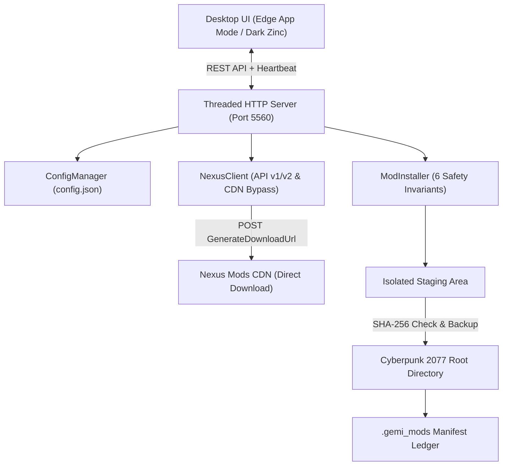

# Cyberpunk 2077 Mod Manager & Nexus Cloudflare Bypass

A lightweight, high-performance Windows desktop application and automation engine designed to download, verify, stage, and install Cyberpunk 2077 mods directly from Nexus Mods with zero Cloudflare Turnstile friction—even on standard Free accounts.


---

## Key Features

- **Free-Tier Nexus Mods Direct CDN Bypass:** Generates verified direct CDN download links (`files.nexus-cdn.com`) with MD5 tokens and signatures using authenticated session cookies, bypassing the 5-second countdown timer and Cloudflare Turnstile barriers.
- **6 Modding Safety Invariants:**
  1. *No Silent Clobber:* Pre-scans existing game directory files and backs up collisions.
  2. *Binary Version Gate:* Validates game executable version prior to deployment.
  3. *Staging Isolation:* Archives are extracted and validated in isolated temporary folders before touching the game directory.
  4. *Transactional Manifest:* Every file written is tracked with its SHA-256 hash in `.gemi_mods/<mod_name>/manifest.json`.
  5. *Reversible Undeploy:* Uninstalling a mod removes only files owned by that mod and safely restores previous backups.
  6. *Automated Sanitation:* Raw downloaded zip archives are automatically purged after successful deployment to keep disk space lean.
- **Native Windows Desktop Experience:** Runs as a borderless Windows desktop app using Microsoft Edge App Mode (`--app`), featuring an automated server lifecycle (server starts on launch and automatically terminates via watchdog when the window is closed).
- **Persistent Credential Manager:** Auto-saves your Nexus Personal API Key and session cookies locally (`config.json`), keeping you logged in across sessions.
- **Batch Update Checker:** Queries Nexus API v1/v2 to check all installed mods for newer releases in a single click.

---

## Architecture



---

## Installation & Setup

### Prerequisites
- Windows 10 / 11 (64-bit)
- Cyberpunk 2077 installed (Steam, GOG, or Epic Games)
- A Nexus Mods account (Free or Premium)

### Option 1: Standalone Windows Binary (Recommended)
1. Download or clone this repository.
2. Build the standalone executable using the included PyInstaller spec:
   ```powershell
   pyinstaller --noconfirm CyberpunkModManager.spec
   ```
3. Run `dist\CyberpunkModManager\CyberpunkModManager.exe` or copy the folder to `%LOCALAPPDATA%\Programs\CyberpunkModManager`.

### Option 2: Run from Source
1. Clone the repository:
   ```bash
   git clone https://github.com/geadalfa/cyberpunk-mod-manager.git
   cd cyberpunk-mod-manager
   ```
2. Copy `config.example.json` to `config.json` and configure your settings:
   ```bash
   cp config.example.json config.json
   ```
3. Launch the application:
   ```powershell
   python server.py
   ```
   or double-click `run.bat`.

---

## Nexus Mods Authentication

To enable automated downloads on a Free Nexus Mods account:

1. **Personal API Key:**
   - Go to [Nexus Mods API Access](https://www.nexusmods.com/users/myaccount?tab=api+access).
   - Scroll to **Personal API Key** at the bottom, generate or copy your key, and paste it into **Form 1**.
2. **Session Cookies (`nexusmods_session` & `nexusmods_session_refresh`):**
   - Open [Nexus Mods](https://www.nexusmods.com) in your browser (logged in).
   - Press `F12` to open Developer Tools and go to the **Application** (or **Storage**) tab.
   - Expand **Cookies** > `https://www.nexusmods.com`.
   - Copy the value of `nexusmods_session` into **Form 3**.
   - Copy the value of `nexusmods_session_refresh` into **Form 4**.
   - Click **Save Settings**. Your credentials are encrypted/stored locally in `config.json`.

---

## Usage

1. Open the application.
2. In the **Mod URL** input, paste any Nexus Mods URL for Cyberpunk 2077 (e.g. `https://www.nexusmods.com/cyberpunk2077/mods/16565`).
3. Click **Inspect Mod** to view available files, file IDs, sizes, and versions.
4. Select the desired file and click **Download & Install Now**.
5. The mod is verified, unpacked, tested for directory compatibility (`r6/`, `bin/x64/`, `archive/pc/mod/`), and deployed with a full rollback manifest.

---

## Safety & Security Invariants

- **Zero Credential Leaks:** `config.json` is strictly ignored by `.gitignore` and never committed to remote repositories.
- **Zero Collision Damage:** If a mod file replaces an existing file, the original is backed up in `.gemi_mods/<mod_name>/backups/` before overwrite.
- **Clean Uninstalls:** Removing a mod restores original files and cleans up empty folders without leaving orphaned artifacts.

---

## License

This project is licensed under the [MIT License](LICENSE).
